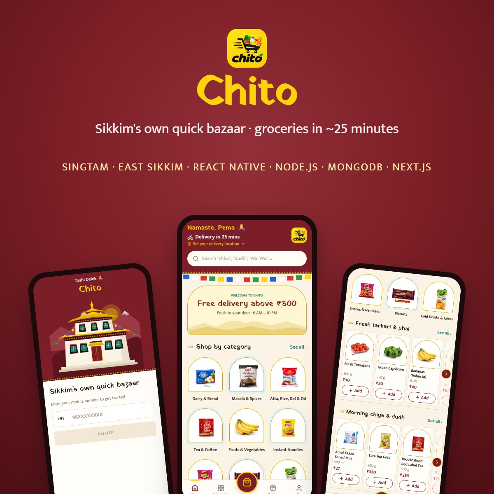
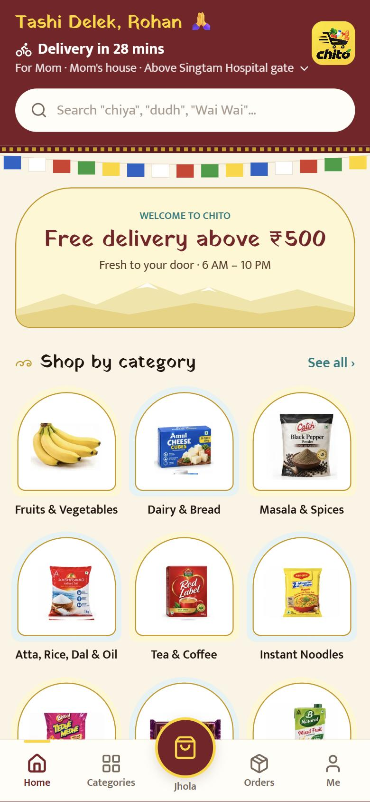
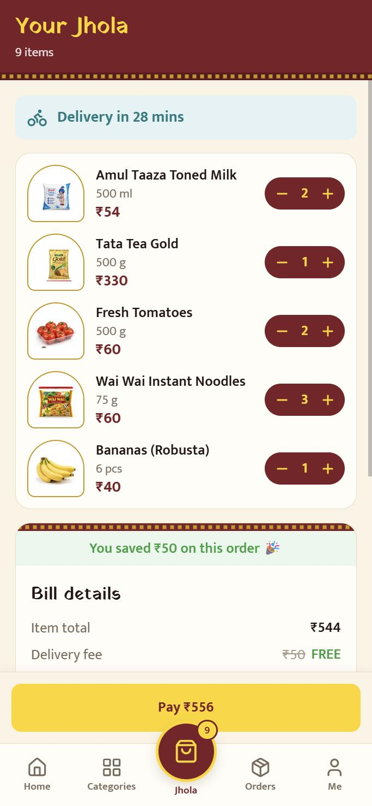
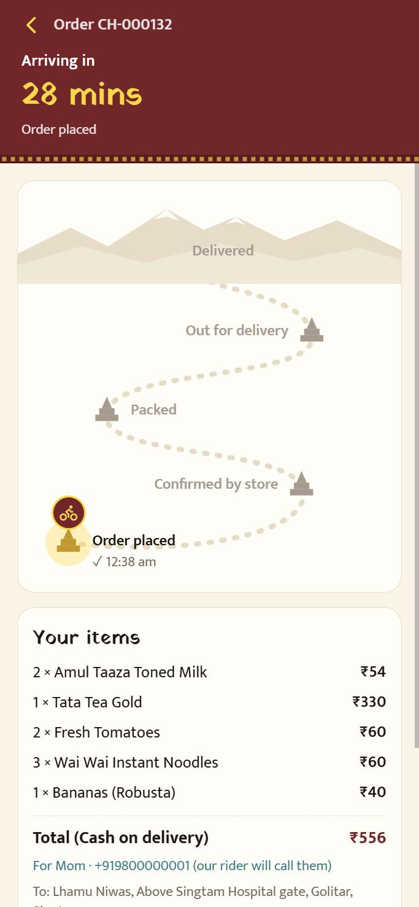
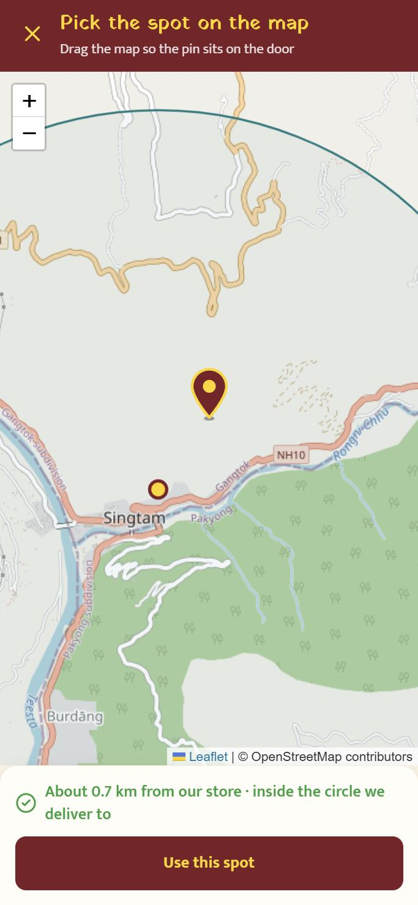
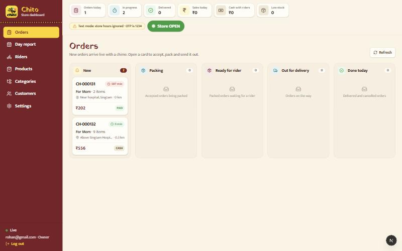

<div align="center">



# Chito

**Sikkim's own quick bazaar.** Groceries from one local store in Singtam Bazaar (East Sikkim), delivered within 3 km in about 25 minutes.

[Try the web app](https://chito-mobile.vercel.app) · [Product spec](PRD.md) · [Design system](DESIGN.md) · [Deploy guide](DEPLOY.md)

</div>

---

## Why

Big quick-commerce apps don't reach small hill towns. Chito is built for one: a single Chito-run store in Singtam Bazaar (737134), open 6 AM – 10 PM, with its own riders. It runs on low-end Android phones and patchy hill 4G, and it looks like home: the "Gompa" design takes its maroon, gold, prayer flags and arched cards from Sikkim's monasteries.

## Three apps, one store

| App | For | Built with |
|---|---|---|
| **Chito** (`apps/mobile`) | Customers on Android and the web | React Native, Expo SDK 57, Expo Router, Zustand |
| **Store dashboard** (`apps/admin`) | The store owner and staff | Next.js 16, Tailwind CSS v4 |
| **Chito Rider** (`apps/rider`) | Delivery riders on Android | React Native, Expo SDK 57 |
| **API** (`apps/api`) | Everything above | Node.js, Express 5, TypeScript, MongoDB (Mongoose 9), Socket.io |

<p align="center">
  
  
  
  
</p>
<p align="center">
  
</p>

## Features

**Customers**
- 170+ products in 24 categories, with search and home shelves
- A "Jhola" (cart) with the full bill: item total, delivery and handling fees, and free delivery above a set amount
- Cash on Delivery, or UPI / cards / netbanking / wallets through Razorpay
- Delivery pin from GPS, a full-screen map, or a WhatsApp / Google Maps location someone shared
- Ordering for someone else (for example "For Mom"), with the rider calling them
- Live order tracking, with the rider's position on a map
- A 4-digit delivery code, so the order is handed to the right person
- Saved addresses that belong to the account, not the phone

**Store**
- Live orders board with a chime: New → Packing → Ready for rider → Out for delivery → Done
- Packing list, printable slip and rider assignment
- Day report: cash collected, online payments, refunds, cash held by each rider, best sellers
- Products (photo upload, price, stock, visibility), categories, riders, customers
- Store settings: hours, fees, minimum order, delivery radius, open/closed switch (for monsoon days)

**Riders**
- Log in with OTP (only numbers the store has added)
- See only their own orders, call the customer, open directions
- Share live location while delivering
- Confirm delivery with the customer's code, or mark it failed with a reason

## How it stays correct

The server is the source of truth. The apps only show what the server allows.

- **3 km radius:** checked on the server for every order, with no bypass, not even in test mode.
- **Prices and bill:** recomputed from the database. Prices sent by the app are ignored.
- **Stock:** reserved atomically inside a MongoDB transaction, and put back on cancellation or payment expiry.
- **Order status:** changes only along an allowed path (`PAYMENT_PENDING → PLACED → CONFIRMED → PACKED → OUT_FOR_DELIVERY → DELIVERED`, plus `CANCELLED` / `DELIVERY_FAILED`). Every change is logged and pushed live over Socket.io.
- **Online payments:** an order is placed only after the server verifies Razorpay's signature or asks Razorpay itself.
  - A signed webhook catches payments that finish after the customer closed the app.
  - Late or duplicate payments are refunded automatically.
  - Unpaid orders expire after about 16 minutes.
- **Idempotent orders:** sending the same `Idempotency-Key` twice creates one order.
- **Atomic money updates:** double clicks can't double-count rider assignment or cash settlement.
- **Auth:** short-lived JWT access tokens and refresh tokens. "Log out everywhere" ends every session. Password and OTP guessing is rate-limited.

## Project layout

```
apps/
  api/      Express + Mongoose + Socket.io API
    src/routes/      customer.ts, admin.ts, rider.ts
    src/services/    orders.ts, store.ts, razorpay.ts (business rules)
    scripts/         seed.ts, e2e.ts, edge.ts
    seed/            categories, products and demo images
  admin/    Next.js store dashboard
  mobile/   Expo customer app
  rider/    Expo rider app
PRD.md      product requirements
DESIGN.md   the Gompa design system
DEPLOY.md   free demo deployment (Render + Vercel + EAS)
DOCKER.md   run everything in one container
```

## Run it locally

You need **Node.js 22+** and a **MongoDB Atlas** database (transactions need a replica set). For online payments you also need **Razorpay** test keys, and **ImageKit** for product photos.

```bash
# 1. API (port 4000)
cd apps/api
cp .env.example .env      # fill in MONGODB_URI, JWT secrets, Razorpay and ImageKit keys
npm install
npm run seed              # store settings, categories, products, first owner admin
npm run dev

# 2. Store dashboard (port 3000)
cd apps/admin
cp .env.example .env.local
npm install
npm run dev

# 3. Customer app
cd apps/mobile
cp .env.example .env      # EXPO_PUBLIC_API_URL = your PC's Wi-Fi IP, e.g. http://192.168.1.5:4000/api/v1
npm install
npx expo start            # or: npm run web

# 4. Rider app
cd apps/rider
cp .env.example .env
npm install
npx expo start            # or: npm run web -- --port 8082
```

In development, `OTP_DEV_MODE=true` sends no SMS and the OTP is always **1234**. A rider can log in only with a phone number added on the dashboard's Riders page. To reach the API from a real phone, allow inbound port 4000 in your firewall.

## Tests

With the API running:

```bash
cd apps/api
npm run typecheck
npm run e2e     # ~110 end-to-end checks: ordering, stock, payments, riders, reports
npm run edge    # 99 edge-case and abuse checks: bad input, races, guessing limits
```

Both suites clean up after themselves. For the apps, run `npx tsc --noEmit` and `npx expo lint` (mobile, rider) or `npm run lint` (admin).

## Deployment

- **API:** Render (`render.yaml`), or a single Docker container ([DOCKER.md](DOCKER.md))
- **Dashboard and web apps:** Vercel
- **Android APKs:** EAS Build (`eas build -p android --profile preview`)
- **Database:** MongoDB Atlas. **Images:** ImageKit. **Payments:** Razorpay (with webhook)

The full walkthrough is in [DEPLOY.md](DEPLOY.md).

## Status

A working demo in **test mode**: OTP is 1234, store hours are ignored and Razorpay uses test keys. Before a real launch:

- [ ] Real SMS OTP (MSG91) and `NODE_ENV=production`
- [ ] Razorpay live keys and a live-mode webhook
- [ ] Google Maps instead of OpenStreetMap tiles
- [ ] Real product photos (the seed images are AI-generated demos)
- [ ] Nepali and Hindi translations
- [ ] Background GPS for riders

---

<div align="center">
Made in Singtam, Sikkim · Tashi Delek 🙏
</div>
